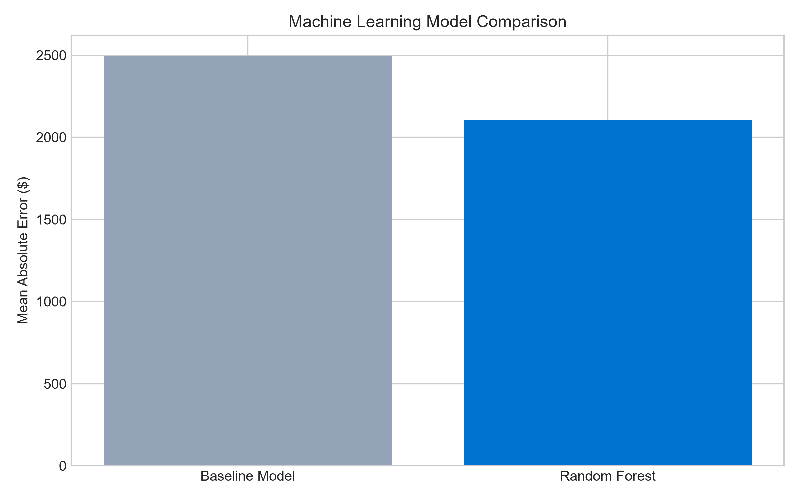
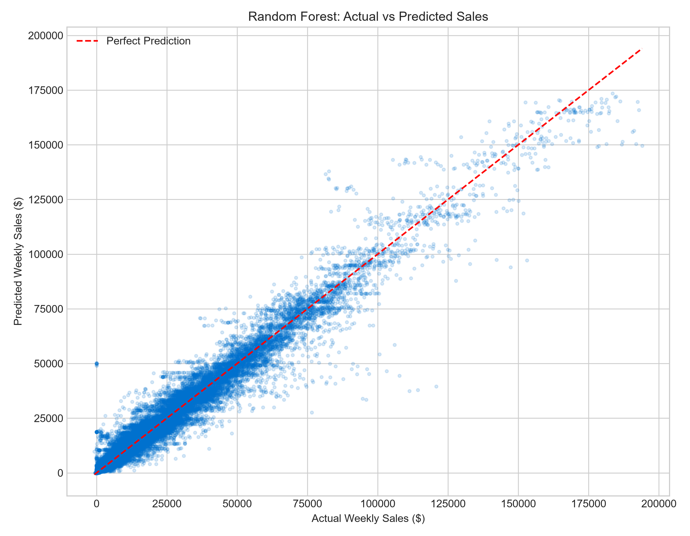
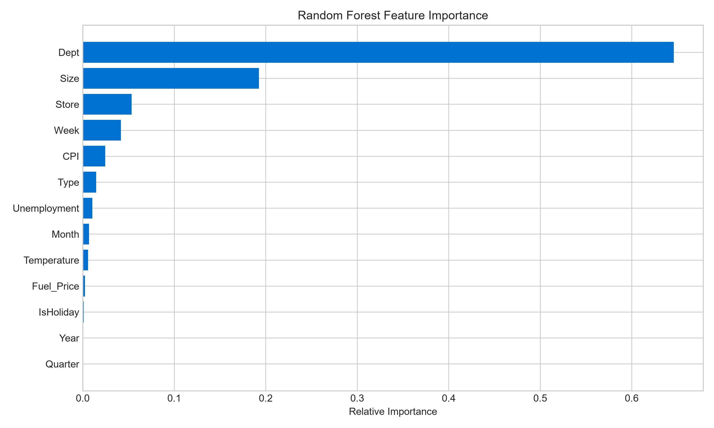
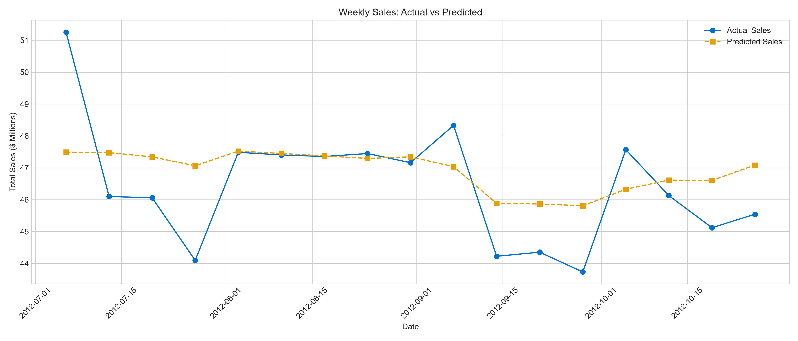

# Walmart Enterprise Sales Analytics

### End-to-End Data Analytics | Business Intelligence | Machine Learning

## Executive Summary

This project presents a comprehensive analysis of Walmart's historical retail sales data from 2010 to 2012, leveraging Advanced Excel, MySQL, Python, Machine Learning and Tableau.

The project transforms raw retail data into actionable business insights through data preparation, statistical exploration, advanced SQL analysis, predictive modeling and interactive executive reporting.

## Project Highlights

| Key Performance Indicator | Value |
|---|---:|
| Total Revenue | $6.74 Billion |
| Total Stores | 45 |
| Unique Departments | 81 |
| Sales Records Analyzed | 421,570 |
| Analysis Period | 2010–2012 |
| Random Forest R² Score | 96.51% |
| Prediction Error Reduction (MAE) | 15.75% |

## Live Interactive Tableau Dashboard

[**Launch Walmart Executive Dashboard**](https://public.tableau.com/views/WalmartEnterpriseSalesAnalytics/WalmartExecutiveDashboard?:showVizHome=no)

The interactive dashboard enables stakeholders to explore:

- Overall sales performance
- Monthly and seasonal sales trends
- Store type performance
- Top 10 departments by sales
- Holiday versus non-holiday sales
- Dynamic KPIs and interactive filtering

## Technology Stack

| Technology | Application |
|---|---|
| Advanced Excel | Data analysis, pivot tables and dashboard reporting |
| MySQL | Advanced querying and business analysis |
| Python | Data cleaning, transformation and analytics |
| Pandas | Data manipulation and aggregation |
| NumPy | Numerical and statistical analysis |
| Matplotlib | Data visualization |
| Scikit-learn | Machine learning and model evaluation |
| Random Forest | Predictive sales modeling |
| Tableau | Interactive executive dashboard |
| GitHub | Version control and project documentation |

## Business Problem

Retail organizations generate large volumes of transactional data. However, transforming this information into meaningful business decisions requires effective data integration, analysis and visualization.

This project addresses the following business questions:

- How does sales performance vary across stores and departments?
- Which store types contribute the most revenue?
- How do holidays and seasonal patterns influence sales?
- What business and economic factors influence retail performance?
- Can historical sales data support predictive sales modeling?
- How can business stakeholders use interactive dashboards to improve decision-making?

## End-to-End Project Architecture

Raw Walmart Datasets

↓

Data Cleaning and Validation

↓

Advanced Excel Analysis

↓

MySQL and Advanced SQL Analysis

↓

Python Exploratory Data Analysis

↓

Machine Learning and Model Evaluation

↓

Tableau Executive Dashboard

↓

Business Insights and Recommendations

## 1. Advanced Excel Analytics

Performed retail sales analysis using Excel to summarize business performance and develop dashboard reporting.

### Key Activities

- Data preparation and validation
- Pivot table analysis
- KPI calculations
- Sales performance reporting
- Trend analysis
- Executive dashboard development

[View Excel Analysis and Dashboard](./excel/)

## 2. Advanced SQL Analytics

Used MySQL to analyze retail sales performance and explore key business drivers.

### Analysis Components

- Overall revenue analysis
- Store-level performance
- Department-level performance
- Sales trend analysis
- Holiday sales comparisons
- Business driver analysis
- Advanced data aggregation

### SQL Scripts

- [Sales Performance Analysis](./sql/01_sales_performance_analysis.sql)
- [Advanced SQL Analysis](./sql/02_advanced_sql_analysis.sql)
- [Business Drivers Analysis](./sql/03_business_drivers_analysis.sql)

## 3. Python Exploratory Data Analysis

Used Python to explore historical retail sales data and identify meaningful patterns.

### Key Activities

- Dataset loading and integration
- Data cleaning and preprocessing
- Exploratory data analysis
- Statistical analysis
- Sales distribution analysis
- Seasonal trend analysis
- Business factor exploration
- Data visualization
- Feature preparation for predictive modeling

[View Complete Python Notebook](./04_walmart_python_analysis.ipynb)

## 4. Machine Learning and Predictive Analytics

Developed and evaluated a Random Forest regression model to predict retail sales using historical data and relevant features.

The model was compared against a baseline model to evaluate improvements in predictive performance.

### Model Performance

| Evaluation Metric | Baseline Model | Random Forest |
|---|---:|---:|
| Mean Absolute Error (MAE) | $2,495.09 | $2,102.24 |
| Root Mean Squared Error (RMSE) | $5,080.62 | $4,102.52 |
| R² Score | 0.9465 | 0.9651 |

### Model Evaluation Insights

- Random Forest reduced mean absolute prediction error by approximately 15.75%.
- RMSE decreased by approximately 19.25%.
- The Random Forest model achieved an R² score of 0.9651.
- The model explained approximately 96.51% of the variance in the evaluated sales data.
- The results demonstrate the potential of machine learning to support retail sales prediction.

### Model Comparison

### Actual vs. Predicted Sales

### Feature Importance

### Weekly Sales Forecast

### Exported Model Results

- [Model Performance](./results/model_performance.csv)
- [Sales Predictions](./results/sales_predictions.csv)
- [Feature Importance](./results/feature_importance.csv)
- [Weekly Sales Forecast](./results/weekly_forecast.csv)

## 5. Tableau Business Intelligence Dashboard

Developed an interactive executive dashboard to communicate analytical findings and enable data-driven business decisions.

### Dashboard Components

- Total Sales KPI
- Total Stores KPI
- Total Departments KPI
- Total Sales Records KPI
- Monthly Sales Trend
- Sales by Store Type
- Top 10 Departments by Sales
- Holiday Sales Analysis

### Interactive Features

- Year-based filtering
- Store type filtering
- Holiday filtering
- Dynamic KPI updates
- Interactive chart selections

[**Explore Live Tableau Dashboard**](https://public.tableau.com/views/WalmartEnterpriseSalesAnalytics/WalmartExecutiveDashboard?:showVizHome=no)

[View Tableau Documentation](./tableau/)

## Key Business Findings

### Store Type Performance

| Store Type | Total Sales |
|---|---:|
| Type A | $4.33 Billion |
| Type B | $2.00 Billion |
| Type C | $0.41 Billion |

Type A stores contributed approximately 64% of total historical sales. Further analysis of store count, store size and sales efficiency would help explain differences between store types.

### Holiday Sales Impact

| Period | Average Weekly Sales per Store-Department Record |
|---|---:|
| Non-Holiday | $15,901.45 |
| Holiday | $17,035.82 |

Average weekly sales per record were approximately 7.1% higher during holiday periods.

### Predictive Analytics

The Random Forest model demonstrated improved predictive performance compared with the baseline model, highlighting the potential value of machine learning in retail demand planning.

## Strategic Business Recommendations

### Inventory Optimization

Use historical sales trends and predictive analytics to support inventory planning and reduce potential stock shortages.

### Holiday Demand Planning

Prepare inventory, staffing and promotional strategies ahead of high-demand holiday periods.

### Store Performance Optimization

Develop store-specific strategies based on sales contribution, store characteristics and operational efficiency.

### Department-Level Strategy

Evaluate high-performing and underperforming departments to identify potential growth opportunities.

### Predictive Decision Support

Use validated predictive models to support demand planning, resource allocation and business forecasting.

## Dataset

The project uses historical Walmart retail sales data covering 2010–2012.

The analysis incorporates store information, historical weekly sales, holiday indicators and relevant business features.

[View Dataset Files](./data/)

## Repository Structure

    walmart-sales-analytics/
    |
    |-- data/
    |-- excel/
    |-- sql/
    |-- results/
    |-- visualizations/
    |-- tableau/
    |-- 04_walmart_python_analysis.ipynb
    |-- README.md

## Project Deliverables

- Advanced Excel sales analysis and dashboard
- MySQL business analytics scripts
- Python exploratory data analysis notebook
- Random Forest predictive model
- Model performance evaluation
- Sales prediction results
- Feature importance analysis
- Data visualizations
- Interactive Tableau executive dashboard
- Business insights and strategic recommendations

## Project Limitations

- The dataset represents historical sales from 2010 to 2012 and does not reflect current Walmart performance.
- Predictive performance depends on the evaluation methodology and available features.
- Further time-based validation is recommended before using the model for operational forecasting.
- Observed relationships do not necessarily establish causation.
- Business recommendations are analytical proposals rather than measured operational outcomes.

## Skills Demonstrated

Data Analytics | Business Analytics | Advanced Excel | SQL | Python | Data Cleaning | Data Validation | Exploratory Data Analysis | Machine Learning | Predictive Analytics | Data Visualization | Tableau | KPI Reporting | Business Intelligence | Data Storytelling | GitHub

## About the Author

**Hari Priya Potu**

Data Analyst | Business Analyst

- M.S. in Data Science
- M.S. in Business Analytics
- 3.5+ Years of Professional Analytics Experience

[Professional Portfolio](https://haripriyapotu.github.io/business-data-analyst-portfolio/)

[GitHub Profile](https://github.com/haripriyapotu)

---

This independent portfolio project demonstrates the application of data analytics, business intelligence and machine learning to real-world retail business challenges.

This project is intended for educational and professional portfolio purposes and is not affiliated with Walmart.
